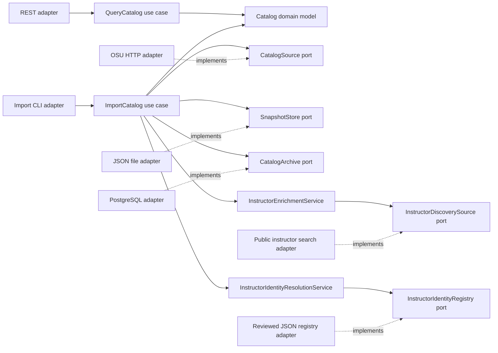

# Hexagonal architecture

The backend keeps course data and use cases independent of Spring, HTTP, JSON libraries, and JPA. Adapters translate external inputs into domain objects; the composition root supplies implementations of the ports. All backend packages below start with `org.osuprofs`.

The dotted arrows represent implementation dependencies: infrastructure depends on interfaces defined by the application, while application services know only the interfaces.

| Layer / package                                           | Responsibility                                                                                                                                   |
| --------------------------------------------------------- | ------------------------------------------------------------------------------------------------------------------------------------------------ |
| `domain.model.Catalog`                                    | Framework-free normalized catalog, courses, sections, instructors, meetings, and source coverage.                                                |
| `application.port.in.QueryCatalog`                        | Supported catalog queries exposed to driving adapters.                                                                                           |
| `application.port.in.ImportCatalog`                       | Import request and import use case exposed to driving adapters.                                                                                  |
| `application.port.out.CatalogSource`                      | Fetch a normalized catalog from an external source.                                                                                              |
| `application.port.out.SnapshotStore`                      | Read and replace a snapshot without exposing filesystem/JSON details.                                                                            |
| `application.port.out.CatalogArchive`                     | Optional durable catalog history and latest-catalog access.                                                                                      |
| `application.port.out.InstructorDiscoverySource`          | Current-term exact-surname search evidence, isolated from session/HTTP parsing.                                                                  |
| `application.port.out.InstructorIdentityRegistry`         | Reviewed full-name candidate metadata and its subject scope, without exposing JSON storage.                                                      |
| `application.service.CatalogQueryService`                 | Catalog search and lookup behavior.                                                                                                              |
| `application.service.CatalogImportService`                | Validate scope/completeness, detect large drops, merge refreshed scopes, and publish through ports.                                              |
| `application.service.InstructorEnrichmentService`         | Join scoped surname evidence to class numbers, distinguish unique/ambiguous candidates, and retain provenance without inventing full identities. |
| `application.service.InstructorIdentityResolutionService` | Join reviewed identity candidates to matching surname evidence, keeping every supported candidate explicitly `LIKELY`.                           |
| `adapter.in.web.CatalogController`                        | Spring REST routing, request/response handling, and input boundaries.                                                                            |
| `adapter.in.cli.ImportCommand`                            | Spring Boot command-line adapter for scheduled and manual imports.                                                                               |
| `adapter.out.osu.OsuCatalogClient`                        | OSU HTTP pagination, source parsing, normalization, and request pacing.                                                                          |
| `adapter.out.osu.PeopleSoftInstructorDiscoveryAdapter`    | Public exact-surname searches, returned-criteria verification, negative control, and class-number evidence.                                      |
| `adapter.out.file.DiscoveryCandidateFile`                 | Read a bounded reviewed surname list without coupling the use case to file formats.                                                              |
| `adapter.out.file.FileInstructorIdentityRegistry`         | Read and validate the reviewed full-name registry, official-source links, and external rating URLs.                                              |
| `adapter.out.file.FileSnapshotStore`                      | JSON serialization and atomic snapshot replacement.                                                                                              |
| `adapter.out.persistence`                                 | PostgreSQL/JPA catalog archive and database entities.                                                                                            |
| `config.CatalogConfiguration`                             | Spring composition root connecting ports to adapters by profile.                                                                                 |

Keep dependency direction explicit: `domain` has no application or adapter dependencies, and `application` has no adapter dependencies or Spring annotations. Put new source integrations behind `CatalogSource`, new storage behind the storage ports, and HTTP-specific behavior in the web adapter. Database entities are not domain models or API contracts.

The `local` profile reads a JSON snapshot and needs no database. The optional `postgres` profile wires the persistence adapter and migrations. The importer completes enabled discovery, joins the reviewed identity registry, and archives before publishing the file, so discovery, registry, or database errors do not replace the existing public snapshot. It merges only the requested term/campus/subject scope, preserving unrelated records such as the included Autumn comparison. Discovery adds a separate nullable `instructorDiscovery` field with optional `fullNameMatches`; it never overwrites the published full-name list. Identity candidates keep explicit `LIKELY` confidence rather than becoming official assignments.

The frontend consumes the same normalized catalog from either `/data/catalog.json` or the optional API's `/api/catalog`. React does not need to know the OSU upstream response shape. `data/catalog-contract.example.json` is the cross-stack contract; coordinate any changes to its `schemaVersion` across the importer, API, and frontend.

## HTTP boundary

All application endpoints are read-only. The importer is a CLI use case, not a public HTTP action.

| Endpoint                           | Response                                                                                   |
| ---------------------------------- | ------------------------------------------------------------------------------------------ |
| `GET /api/catalog`                 | Full normalized catalog, with collection metadata and a short cache lifetime.              |
| `GET /api/health` or `/api/status` | Application status, data availability, counts, and coverage.                               |
| `GET /api/terms`                   | Available term options in the snapshot.                                                    |
| `GET /api/subjects`                | Available subject options in the snapshot.                                                 |
| `GET /api/campuses`                | Available campus options in the snapshot.                                                  |
| `GET /api/courses`                 | Paginated course query using `q`, `term`, `subject`, `number`, `instructor`, and `campus`. |
| `GET /api/courses/{id}`            | One normalized course, or HTTP 404.                                                        |
| `GET /api/instructors?q=...`       | Matching unique published instructor identities.                                           |

Course pagination is zero-based (`page=0`); `size` defaults to 25 with a maximum of 100. `number` is an exact catalog-number filter, while `q` searches titles, normalized subject/number combinations, and instructor names/surname evidence/likely full names. The frontend instructor browser combines published identities and reviewed full-name candidates, with section-specific published/likely labels and source links. Example: `/api/courses?term=1272&subject=CSE&number=2221&page=0&size=25`.

This is one deployable backend rather than separate microservices. The importer and REST API are different entry points into the same application core. At free-tier scale, use a single scheduled importer; introduce distributed coordination only if multiple import workers become necessary.
