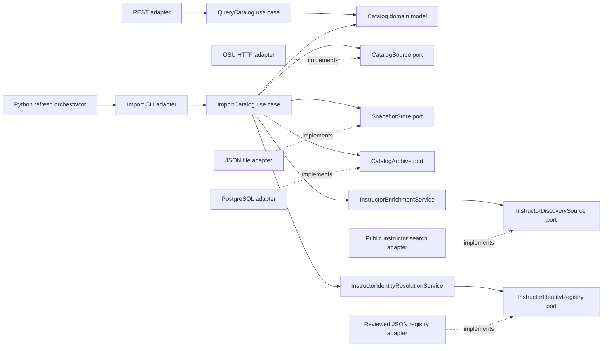

# Hexagonal architecture

The backend keeps course data and use cases independent of Spring, HTTP, JSON libraries, and JPA. Adapters translate external inputs into domain objects; the composition root supplies implementations of the ports. All backend packages below start with `org.osuprofs`.



The dotted arrows represent implementation dependencies: infrastructure depends on interfaces defined by the application, while application services know only the interfaces.

| Layer / package                                           | Responsibility                                                                                                                                   |
| --------------------------------------------------------- | ------------------------------------------------------------------------------------------------------------------------------------------------ |
| `domain.model.Catalog`                                    | Framework-free normalized catalog, courses, sections, instructors, meetings, and source coverage.                                                |
| `application.port.in.QueryCatalog`                        | Supported catalog queries exposed to driving adapters.                                                                                           |
| `application.port.in.ImportCatalog`                       | Import request and import use case exposed to driving adapters.                                                                                  |
| `application.port.out.CatalogSource`                      | Discover offered subjects and fetch a normalized catalog from an external source.                                                                |
| `application.port.out.SnapshotStore`                      | Read and replace a snapshot without exposing filesystem/JSON details.                                                                            |
| `application.port.out.CatalogArchive`                     | Optional durable catalog history and latest-catalog access.                                                                                      |
| `application.port.out.InstructorDiscoverySource`          | Current-term exact-surname search evidence, isolated from session/HTTP parsing.                                                                  |
| `application.port.out.InstructorIdentityRegistry`         | Reviewed full-name candidate metadata and its subject scope, without exposing JSON storage.                                                      |
| `application.service.CatalogQueryService`                 | Catalog search and lookup behavior.                                                                                                              |
| `application.service.CatalogImportService`                | Validate scope/completeness, detect large drops, merge refreshed scopes, and publish through ports.                                              |
| `application.service.InstructorEnrichmentService`         | Join scoped surname evidence to class numbers, distinguish unique/ambiguous candidates, and retain provenance without inventing full identities. |
| `application.service.InstructorIdentityResolutionService` | Join reviewed identity candidates to matching surname evidence, keeping every supported candidate explicitly `LIKELY`.                           |
| `adapter.in.web.CatalogController`                        | Spring REST routing, request/response handling, and input boundaries.                                                                            |
| `adapter.in.cli.ImportCommand`                            | Spring Boot command-line adapter for scheduled and manual imports.                                                                               |
| `adapter.out.osu.OsuCatalogClient`                        | OSU HTTP pagination, source parsing, normalization, and request pacing.                                                                          |
| `adapter.out.osu.PeopleSoftInstructorDiscoveryAdapter`    | Public exact-surname searches, returned-criteria verification, negative control, and class-number evidence.                                      |
| `adapter.out.file.DiscoveryCandidateFile`                 | Read a bounded reviewed surname list without coupling the use case to file formats.                                                              |
| `adapter.out.file.FileInstructorIdentityRegistry`         | Read and validate the reviewed full-name registry, official-source links, and external rating URLs.                                              |
| `adapter.out.file.FileSnapshotStore`                      | Read a flat catalog or validated manifest/files, and atomically replace working snapshots.                                                       |
| `adapter.out.persistence`                                 | PostgreSQL/JPA catalog archive and database entities.                                                                                            |
| `config.CatalogConfiguration`                             | Spring composition root connecting ports to adapters by profile.                                                                                 |

Keep dependency direction explicit: `domain` has no application or adapter dependencies, and `application` has no adapter dependencies or Spring annotations. Put new source integrations behind `CatalogSource`, new storage behind the storage ports, and HTTP-specific behavior in the web adapter. Database entities are not domain models or API contracts.

The `local` profile reads JSON files and needs no database. The optional `postgres` profile wires the persistence adapter and migrations. One Java import validates a requested term/campus/subject scope, runs enabled enrichment and identity resolution, archives if configured, then atomically replaces its working file. Errors in that import do not replace its previous snapshot. `ALL` subject imports discover the offered subjects through the source port and retain source count checks.

The importer preserves unrelated scopes and previously collected instructor evidence on base-only refreshes. It can read a separate history snapshot through `SnapshotStore`, so historical published names support candidate resolution without being mistaken for new assignments. `instructorDiscovery` and its optional `fullNameMatches` remain separate from the source’s published instructor list. Identity candidates keep explicit `LIKELY` confidence. Optional `section.details` carries public session dates, linked-section identifiers, consent, attributes and an official availability URL.

## University collection and static publication

`data/bootstrap/refresh_university.py` is a driving adapter for scheduled operations. It runs the Java CLI for every selected campus with `ALL` subjects, validates campus totals against the public source and maintains a local working directory. Historical records live in a separate build-only input for identity resolution. The orchestrator selects only the upcoming term before static publication. It does not move Spring/HTTP/file dependencies into the Java application core.

The orchestrator builds subject-specific surname queues from published upcoming/history records and reviewed inputs. Previously unsearched queries run first, followed by changed scopes and then expired checks oldest first, so the pending tail continues to advance. Each batch invokes the same Java import use case with at most 40 surnames. Completed queries are recorded with a source-check time and a fingerprint of the scope’s section IDs. Scheduled refreshes can stop between batches at their time budget and resume later. Failed batches preserve their earlier data and remain queued; the receipt exposes their failure separately from base-collection completeness.

`publish_catalog.py` validates the merged catalog and splits whole subject scopes into files grouped by term/campus, targeting 4 MiB per file and rejecting files over 24 MiB. Content-hashed filenames are written before the new index is atomically published. The manifest is a delivery format:

```json
{
  "schemaVersion": 1,
  "generatedAt": "2026-10-20T00:00:00Z",
  "catalogs": [
    {
      "url": "/data/catalogs/1272-col-1-CONTENT_HASH.json",
      "termCode": "1272",
      "campus": "col",
      "subjects": ["CSE", "MATH"],
      "courseCount": 100,
      "sectionCount": 500
    }
  ]
}
```

The values above illustrate the format, not live coverage counts. Every referenced file is a complete normalized Catalog schema 1 document for its declared scope. Scopes cannot overlap, paths must stay within `/data/`, and course IDs must be unique across the merged catalog. Term/subject/campus metadata is deduplicated by code. `data/catalog-contract.example.json` describes normalized records; changes to that contract must remain coordinated across Java, the API and React.

The frontend’s catalog adapter loads up to four files concurrently, validates counts/scopes and accepts the result atomically. A failed file cannot silently produce partial coverage. An HTTP 404 for the index enables the legacy single-file fallback. The optional `/api/catalog` response is restricted to the public snapshot’s upcoming terms and used only when it preserves every static scope’s freshness and richer instructor/section information. If that public snapshot cannot be loaded, the UI requests a retry rather than accepting an unverified API-only term list. React’s domain layer works with the merged normalized catalog and does not know the upstream class-search shape.

The separate frontend availability adapter requests the official public seat endpoint only after a user selects **Check current seats**. It validates the URL and response, sends no credentials, and keeps the live result/check time separate from stored snapshot enrollment fields. Browser search and schedule planning continue without this request.

## HTTP boundary

All application endpoints are read-only. The importer is a CLI use case, not a public HTTP action.

| Endpoint                           | Response                                                                                   |
| ---------------------------------- | ------------------------------------------------------------------------------------------ |
| `GET /api/catalog`                 | Full normalized catalog, with collection metadata and a short cache lifetime.              |
| `GET /api/health` or `/api/status` | Application status, data availability, counts, and coverage.                               |
| `GET /api/terms`                   | Available term options in the snapshot.                                                    |
| `GET /api/subjects`                | Available subject options in the snapshot.                                                 |
| `GET /api/campuses`                | Available campus options in the snapshot.                                                  |
| `GET /api/courses`                 | Paginated course query using `q`, `term`, `subject`, `number`, `instructor`, and `campus`. |
| `GET /api/courses/{id}`            | One normalized course, or HTTP 404.                                                        |
| `GET /api/instructors?q=...`       | Matching unique published instructor identities.                                           |

Course pagination is zero-based (`page=0`); `size` defaults to 25 with a maximum of 100. `number` is an exact catalog-number filter, while `q` searches titles, normalized subject/number combinations, and instructor names/surname evidence/likely full names. The frontend instructor browser combines published identities and reviewed full-name candidates, with section-specific published/likely labels and source links. Example: `/api/courses?term=1272&subject=CSE&number=2221&page=0&size=25`.

This is one deployable backend rather than separate microservices. The importer and REST API are different entry points into the same application core. Use one scheduled refresh job with persisted batch progress. Its queue and published static files provide broader coverage without requiring an always-running service or distributed workers.
